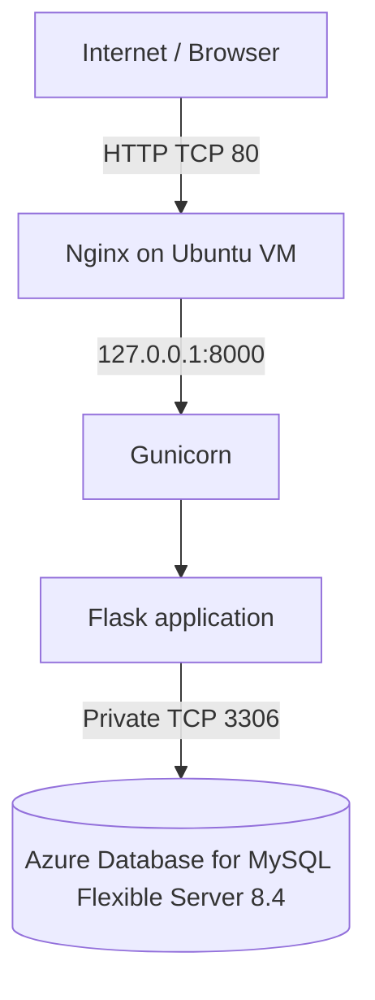

# Azure Two-Tier Web Application

A hands-on Azure project demonstrating a public web tier and a private database tier.

## Architecture



## Technologies

- Microsoft Azure Virtual Network
- Ubuntu Server 24.04 LTS
- Nginx reverse proxy
- Gunicorn WSGI server
- Python and Flask
- Azure Database for MySQL Flexible Server 8.4
- Private VNet integration and Network Security Groups
- Linux systemd service management

## Implemented and tested

- Created a VNet with separate web and database subnets.
- Deployed an Ubuntu web VM in the web subnet.
- Deployed MySQL Flexible Server using private VNet integration.
- Confirmed private DNS resolution from the web VM.
- Confirmed TCP connectivity to MySQL on port 3306.
- Created the `twotierapp` database and `visitors` table.
- Built a Flask application to read visitor records and insert new records.
- Ran Flask behind Gunicorn.
- Configured a systemd service for Gunicorn.
- Configured Nginx to proxy HTTP requests to Gunicorn.
- Tested application response and database read/write operations.

## Network design

Example lab addressing (adjust to your own environment):

| Component | Address |
|---|---|
| VNet | `10.0.0.0/16` |
| Web subnet | `10.0.1.0/24` |
| Database subnet | `10.0.2.0/24` |
| Web VM private IP | `10.0.1.4` |
| MySQL private IP observed in lab | `10.0.2.4` |

Security intent:

- Allow SSH only from a trusted administrator source IP.
- Allow inbound HTTP TCP 80 to the web subnet.
- Allow MySQL TCP 3306 from the web subnet only.
- Do not expose MySQL publicly.
- Keep credentials in a protected `.env` file, never in source control.

## Database schema

```sql
CREATE DATABASE twotierapp;
USE twotierapp;

CREATE TABLE visitors (
    id INT AUTO_INCREMENT PRIMARY KEY,
    visitor_name VARCHAR(100) NOT NULL,
    created_at TIMESTAMP DEFAULT CURRENT_TIMESTAMP
);
```

## Deployment outline

1. Create the Azure VNet and separate web/database subnets.
2. Associate suitable NSGs with the subnets.
3. Delegate the database subnet to `Microsoft.DBforMySQL/flexibleServers`.
4. Deploy the MySQL Flexible Server with private networking.
5. Deploy Ubuntu 24.04 in the web subnet.
6. Install Nginx, Python virtual environment tools and MySQL client tools.
7. Copy `app/app.py` to `/opt/twotierapp/app.py`.
8. Create a virtual environment and install `requirements.txt`.
9. Copy `.env.example` to `/opt/twotierapp/.env`, enter your own credentials and restrict permissions:

   ```bash
   sudo chown Max:Max /opt/twotierapp/.env
   chmod 600 /opt/twotierapp/.env
   ```

10. Create the database and `visitors` table using the SQL above.
11. Install `deploy/twotierapp.service` as `/etc/systemd/system/twotierapp.service`.
12. Install `deploy/nginx-twotierapp.conf` as `/etc/nginx/sites-available/twotierapp`, enable it, test Nginx and reload.

## Local application test

```bash
cd /opt/twotierapp
python3 -m venv venv
source venv/bin/activate
pip install -r requirements.txt
python app.py
```

For the service deployment, Gunicorn listens only on `127.0.0.1:8000`; Nginx listens on port 80.

## Verification commands

```bash
getent hosts your-mysql-server.mysql.database.azure.com
nc -vz your-mysql-server.mysql.database.azure.com 3306
sudo systemctl status twotierapp --no-pager
sudo nginx -t
curl -i http://127.0.0.1
```

## Cost and cleanup

Azure VM compute, managed disks, public IP, MySQL compute, storage, backups, networking and data transfer can incur charges. Actual costs depend on region, SKU, usage, discounts and free-benefit eligibility. Check the Azure Pricing Calculator and Cost Management before leaving resources running.

For a lab, stop/deallocate the VM when not in use. Remember that disks, public IPs and MySQL resources may continue to incur charges. Delete the resource group when the project is no longer needed, after backing up anything you want to keep.

## Security and production notes

This is a learning project, not a production-ready service. Before production use:

- Configure HTTPS with a trusted certificate.
- Use a dedicated least-privilege MySQL application account instead of the server administrator.
- Use managed identity or a secrets manager where supported.
- Enable database TLS certificate validation and keep CA certificates current.
- Add CSRF protection, input validation, rate limiting and secure session handling as needed.
- Add monitoring, backups, patching, logging and alerting.
- Review SSH exposure and restrict it to trusted source addresses.
- Do not publish real public IPs, passwords, private keys, subscription IDs or tenant IDs in screenshots or repository content.

## Repository contents

```text
.
├── app/
│   └── app.py
├── deploy/
│   ├── nginx-twotierapp.conf
│   └── twotierapp.service
├── .env.example
├── .gitignore
├── README.md
└── requirements.txt
```
