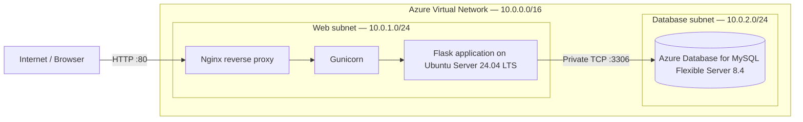

# Azure Two-Tier Web Application

A hands-on Microsoft Azure project demonstrating a public-facing web tier and a privately connected database tier.

## Architecture



## Technology stack

- **Cloud:** Microsoft Azure
- **Network:** Azure Virtual Network, separate web and database subnets, Network Security Groups, private DNS
- **Web tier:** Ubuntu Server 24.04 LTS, Nginx, Gunicorn, Python Flask
- **Database tier:** Azure Database for MySQL Flexible Server 8.4

## What I implemented

- Created an Azure virtual network with separate web and database subnets.
- Deployed an Ubuntu Linux virtual machine for the web application.
- Configured Nginx as a reverse proxy to Gunicorn and Flask.
- Ran the Flask application as a systemd service.
- Configured private connectivity from the web tier to Azure MySQL.
- Restricted database access to the web subnet using network security rules.
- Created a visitor table and tested database insert and read operations.

## Application flow

1. A browser sends an HTTP request to the public web endpoint.
2. Nginx receives the request on port 80 and forwards it to Gunicorn on localhost port 8000.
3. Gunicorn runs the Flask application.
4. Flask connects to Azure Database for MySQL over the private network on TCP port 3306.
5. The application reads and writes visitor records.

## Example lab network

| Component | Address |
|---|---|
| VNet | `10.0.0.0/16` |
| Web subnet | `10.0.1.0/24` |
| Database subnet | `10.0.2.0/24` |

## Repository structure

```text
.
├── app/
│   └── app.py
├── deploy/
│   ├── nginx-twotierapp.conf
│   └── twotierapp.service
├── .env.example
├── .gitignore
├── requirements.txt
└── README.md
```

## Deployment notes

- Install dependencies from `requirements.txt`.
- Set database connection values using environment variables or a local `.env` file based on `.env.example`.
- Never commit the real `.env` file.
- The deployment examples in `deploy/` are references; update paths and Linux service account names for your environment.

## Security notes

This is a learning project, not a production-ready application. Before production use, configure HTTPS, secure cookie/session settings, CSRF protection, input validation, TLS certificate verification for database connections, least-privilege database credentials, monitoring and tested backups. Restrict SSH to trusted source IPs.

## Cost and cleanup

Azure virtual machines, managed databases, disks, public IPs, backups and networking can incur charges. Stop/deallocate compute when it is not in use, but note that storage and some other resources can continue to bill. Delete the resource group after saving anything you need to stop the lab resources. Check Azure Cost Management for any remaining charges.

## Learning outcomes

Practical experience with Azure networking, Linux administration, Nginx reverse proxy, Python application hosting, managed MySQL connectivity and network security.
